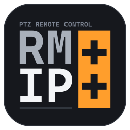
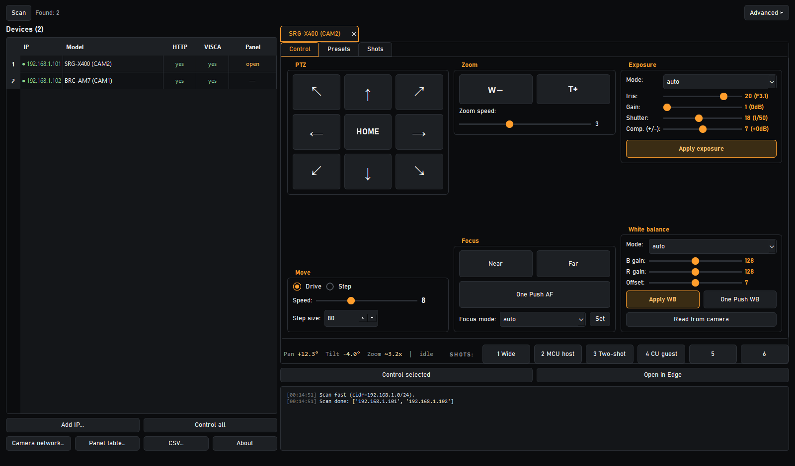
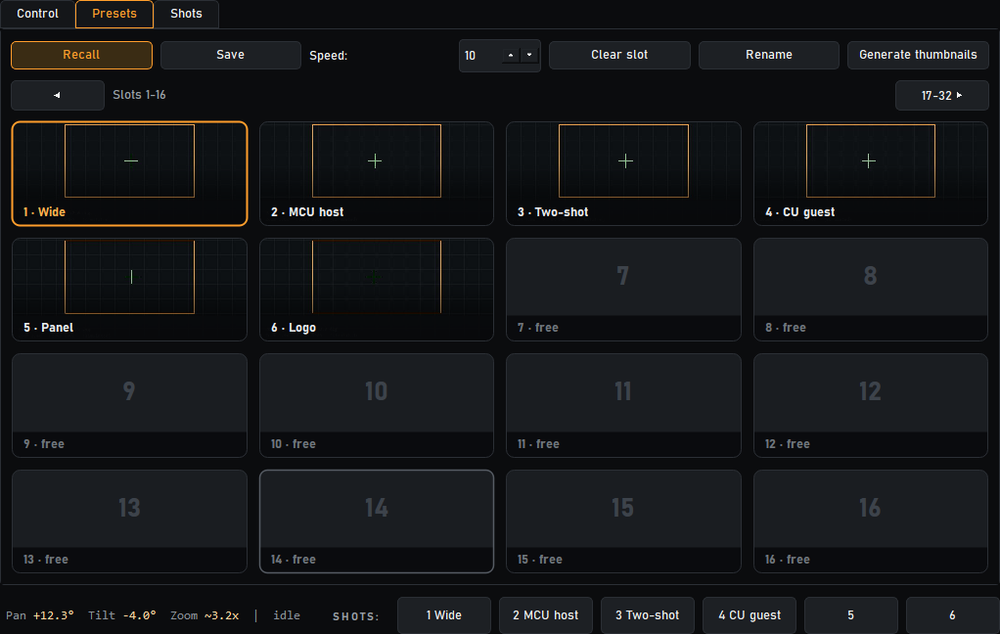
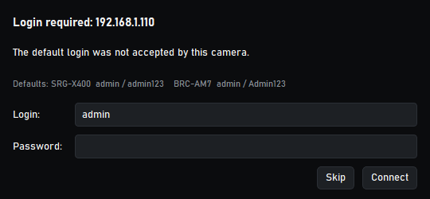

<p align="center">
  
</p>

<h1 align="center">RM IP++</h1>

<p align="center">
  <b>Sony IP camera control console for live production</b><br>
  PTZ &middot; camera presets &middot; local shots &middot; exposure &amp; white balance &middot; Wi-Fi + Ethernet bridge
</p>

<p align="center">
  
  
  
  
</p>



One window, one tab per camera. No video preview &mdash; the camera feeds SDI/HDMI
to the mixer, and the app talks to it over HTTP CGI (Digest) and UDP.

## Features

- **Camera discovery** &mdash; ARP, SSDP and Sony UDP 52380 (`ENQ:network`),
  known IPs and a full CIDR scan, with progress and a Stop button.
- **PTZ** &mdash; 8-way pad with **Drive** (move while held) and **Step**
  (precise single step, hold to glide), speed 0&ndash;24, zoom and focus.
- **Camera presets 1&ndash;256** &mdash; grid with names, recall/save/clear,
  recall speed and thumbnails taken from the camera image.
- **Shots 1&ndash;16 + quick 1&ndash;6** &mdash; local positions that store
  **only pan/tilt/zoom/focus** (`AbsolutePTZF`). They never touch exposure,
  white balance or colours.
- **Image** &mdash; exposure (mode, iris, gain, shutter, compensation) and white
  balance with state read back from the camera; values in camera units
  (F, dB/EV, 1/..., frames).
- **Camera network over UDP** &mdash; change IP / mask / gateway / name by MAC
  (`SET` + ACK/NAK), works even when the camera is outside the PC subnet
  (requires `WRITE:on`).
- **RM-IP500 panel table** &mdash; `ENQ:camtable 1..4`, 112 slots, read-only
  view and Sony-format CSV export/import.
- **Network bridge** &mdash; adds secondary IPs on Ethernet for unreachable
  cameras (one UAC prompt). **Wi-Fi with Internet stays untouched**; temporary
  IPs are removed on exit and orphans are cleaned on the next start.
- **Automatic logins** &mdash; per-model defaults, a per-camera prompt when they
  are rejected, remembered per IP.
- **Demo camera** &mdash; explore every tab without any hardware.
- **English UI** with tooltips, dark amber theme and an About window.

## Screenshots

| Control | Presets |
|---|---|
|  |  |

| Shots | Camera login |
|---|---|
|  |  |

<sub>Screenshots generated with the built-in demo camera (sample data).</sub>

## Download and run

Grab the latest single-file exe from
**[Releases](https://github.com/wertos97/rm-ip-plus-plus/releases/latest)**:

1. Run `RMIPpp_0.1_win64.exe`. No installation, no Python.
   It unpacks itself to `%TEMP%` on start (the window appears after a few seconds).
2. SmartScreen may warn about an unsigned app: **More info &rarr; Run anyway**.
3. The app scans the network on start. Double-click a camera to open its tab.

On first run the exe registers a Start Menu shortcut **RM IP++** with its
AppUserModelID &mdash; Windows 11 uses it for the taskbar icon. Keep the exe in a
fixed folder; the shortcut is refreshed automatically when the path changes.

### Camera logins

Default credentials are tried automatically:

| Model | Login | Password |
|---|---|---|
| SRG-X400 / BRC-X400 | `admin` | `admin123` |
| BRC-AM7 | `admin` | `Admin123` |

If a camera rejects them (HTTP 401), the app asks for its login and password and
remembers them **for that IP** in the config. Different cameras can use
different credentials.

### No cameras? Try the demo

After a scan with no devices, the list shows **Add demo camera**. It adds a
simulated camera (no network traffic) so you can explore PTZ, presets, shots and
the image panel safely.


## Supported models

- **SRG-X400 / BRC-X400** (and relatives with the same CGI) &mdash; full support,
  verified live on SRG-X400.
- **BRC-AM7** &mdash; mapped from Sony *CGI Command List v2.0*, detected
  automatically (`inq=viewermode` &rarr; ModelName). Differences: focus Near/Far
  moves in steps (`AbsoluteFocus`, no continuous focus over CGI), preset recall
  by number only, three auto switches instead of `ExposureMode`, iris/gain in
  AM7 units, shutter 50p, WB `atw` / `memory_a` / `preset`, One Push AF/WB as
  press+release.
  **The BRC-AM7 command set has not yet been verified on hardware.**

## Network bridge (Wi-Fi + Ethernet)

Production laptops usually keep Internet on Wi-Fi while cameras live on a
dedicated Ethernet segment. The app adds only temporary secondary IPs
(`SkipAsSource`, no gateway) on the physical Ethernet adapter, so camera traffic
goes over the cable and Internet keeps using Wi-Fi.

- Windows asks for admin rights **once** (UAC) per bridge operation.
- Temporary IPs are removed when the app exits; leftovers from a crash are
  detected and cleaned on the next start.
- The bridge is L3 only &mdash; it does not replace the cable, PoE or power.

## Build from source

Requirements: Windows 10/11, Python 3.12.

```powershell
python -m venv .venv
.venv\Scripts\activate
pip install -r requirements.txt
python main.py           # console window
pythonw main.py          # no console window
```

Run the tests:

```powershell
python tests/test_basic.py
```

Build the portable single-file exe (PyInstaller, icon, version metadata):

```powershell
powershell -ExecutionPolicy Bypass -File build.ps1
```

Result: `dist/RMIPpp_0.1_win64.exe`.

## Developer tools

| Tool | Purpose |
|---|---|
| `python tools/udp_probe.py` | Sony UDP 52380 diagnostics: discovery, `ENQ:camtable`, network `SET` |
| `python tools/mock_sony_cam.py` | Fake Sony camera on `127.0.0.1:8080` + `:52381` |
| `python tools/make_screenshots.py` | Regenerate the screenshots in `assets/screenshots` |
| `python tools/make_ico.py` | Rebuild `assets/icon.ico` from the SVG |
| `python tools/make_version_info.py` | Generate Windows version metadata for the build |
| `python tools/test_poll_responsive.py` | Check that status polling never blocks the GUI |
| `python tools/inspect_am7.py` | Render the BRC-AM7 UI with a fake API (no hardware) |

## Project layout

```text
main.py                 entry point (theme, icon, AUMID)
src/
  ui_main.py            main window, device table, scan worker, About
  ui_control.py         camera tab: PTZ, presets, shots, exposure/WB
  ui_udp.py             camera network SET, RM-IP panel table, CSV
  ui_creds.py           login/password dialog
  cam_control.py        camera CGI API (SRG + BRC-AM7)
  sony_client.py        HTTP Digest client
  sony_udp.py           Sony UDP 52380 (discovery, SET, camtable)
  sony_csv.py           Sony-format CSV (camera list + panel table)
  discovery.py          ARP / SSDP / parallel probe
  net_manager.py        adapters, temporary IPs, UAC, cleanup
  subnet_bridge.py      SSDP M-SEARCH, ARP, bridge address selection
  edge_view.py          Edge/Chrome app window per camera
  human.py              camera value <-> human-readable units
  creds.py              per-camera credential resolution
  demo_api.py           simulated camera (demo mode)
  win_shortcut.py       Start Menu shortcut with AppUserModelID
  config_store.py       %APPDATA%/RMIP++/config.json
  theme.py              dark amber theme
  version.py            version (UI + exe metadata)
tests/test_basic.py     protocol / parsing / credential / demo tests
tools/                  developer utilities
assets/                 icon + screenshots
```

## Local data and privacy

The exe is portable (no installer), but the app stores user-scoped state:

- `%APPDATA%\RMIP++\config.json` &mdash; settings, known IPs, shots, open tabs and
  **camera passwords in plain text** (protected by your Windows profile ACL).
- `%APPDATA%\RMIP++\edge_profile\` &mdash; only if you use *Open in Edge*
  (dedicated browser profile with cookies/cache).
- `%LOCALAPPDATA%\RMIP++\icon.ico`, a Start Menu shortcut and the
  `HKCU\Software\Classes\AppUserModelId\wertos97.RMIPPlusPlus.App` registry key
  (taskbar icon).
- `%TEMP%\rmip_thumbs\` (preset thumbnails) and `%TEMP%\rmip_pp_temp_ips.json`
  (bridge cleanup state).
- The single-file exe is unpacked to `%TEMP%\_MEIxxxx` while running; a clean
  exit removes it.

No services, autostart entries, scheduled tasks, drivers or telemetry. Nothing
is written outside your user profile and `%TEMP%`.

To remove all traces: delete `%APPDATA%\RMIP++`, `%LOCALAPPDATA%\RMIP++`, the
Start Menu shortcut, the registry key above, and `%TEMP%\rmip_thumbs` &
`%TEMP%\rmip_pp_temp_ips.json`.

## Limitations

- No video preview by design; use the camera's SDI/HDMI output.
- UDP `SET` requires `WRITE:on` in the camera (state shown in the device tooltip).
- The RM-IP500 panel table is read-only (no write back to the panel).
- Shots store position only &mdash; not exposure, white balance or colours.
- Cameras unreachable at startup do not reopen their tabs automatically.
- BRC-AM7 commands still need validation on real hardware.

## Disclaimer

Sony, SRG, BRC, IPELA and RM-IP are trademarks of Sony Corporation. This project
is not affiliated with or endorsed by Sony. Use at your own risk, especially for
network changes on production cameras.

## License

Copyright &copy; 2026 wertos97. **All rights reserved.** No permission is granted
to use, copy, modify or distribute this software or its binaries without written
permission from the author. The source is published for reference and
collaboration; contact the author if you want to use it in your own project.
