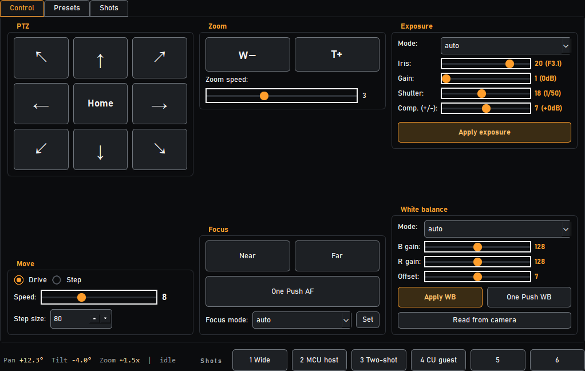
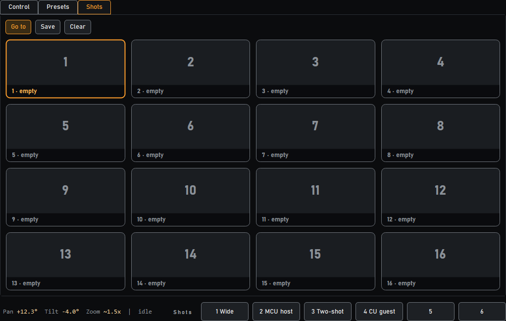
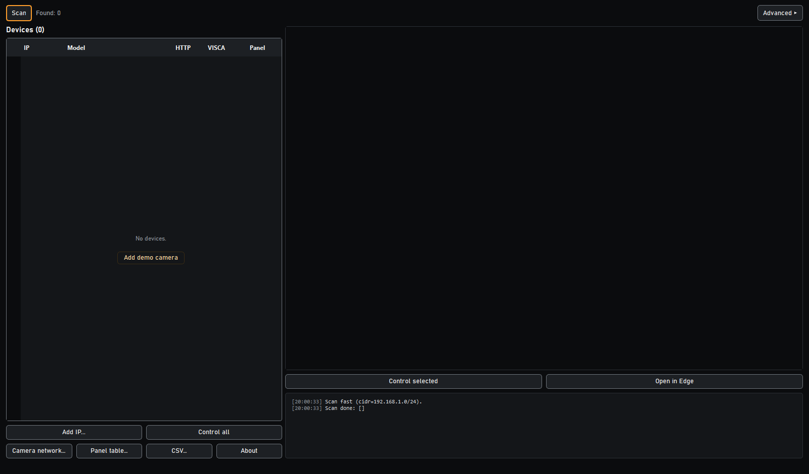

<p align="center">
  
</p>

<h1 align="center">RM IP++</h1>

<p align="center">
  <b>Sony IP camera control for live production</b><br>
  PTZ, camera presets, local shots, exposure, white balance and a Wi-Fi + Ethernet bridge.
</p>

<p align="center">
  
  
  
  
</p>

RM IP++ is a desktop console for Sony IP cameras used in live production on Windows and macOS. It opens one control tab per camera and talks to the camera over HTTP CGI with Digest authentication and Sony UDP.

There is no video preview by design. Camera feeds go to the mixer over SDI or HDMI.

**License:** source-available, all rights reserved. See [LICENSE](LICENSE).

## Contents

- [Quick start](#quick-start)
- [macOS preview](#macos-preview)
- [Features](#features)
- [Screenshots](#screenshots)
- [Camera logins](#camera-logins)
- [Supported cameras](#supported-cameras)
- [Network bridge](#network-bridge)
- [Development](#development)
- [Developer tools](#developer-tools)
- [Project layout](#project-layout)
- [Local data and privacy](#local-data-and-privacy)
- [Limitations](#limitations)

## Quick start

Download the latest single-file executable from [Releases](https://github.com/wertos97/rm-ip-plus-plus/releases/latest).

1. Run `RMIPpp_0.1_win64.exe`. No installation or Python is required.
2. If SmartScreen warns about an unsigned app, choose **More info**, then **Run anyway**.
3. The app scans the network on startup. Double-click a camera to open its control tab.

The executable unpacks itself to `%TEMP%` while running. On first launch it registers a Start Menu shortcut and an AppUserModelID for the Windows 11 taskbar icon. Keep the executable in a fixed folder; the shortcut is refreshed when its path changes.

## macOS preview

Download `RMIPpp_0.1_macos_arm64.zip` from the [macOS preview release](https://github.com/wertos97/rm-ip-plus-plus/releases/tag/v0.1-macos-preview).

1. Unzip the file.
2. Move `RM IP++.app` to Applications.
3. Right-click the app and choose **Open**, then confirm **Open** again.
4. If macOS still blocks it, open **System Settings → Privacy & Security** and choose **Open Anyway**.

The macOS build is for Apple Silicon and macOS 13 or newer. It is ad-hoc signed but not notarized, so Gatekeeper shows a warning on first launch. This preview has not yet been tested on a physical Mac or camera.

## Features

- **Camera discovery:** ARP, SSDP and Sony UDP 52380 (`ENQ:network`), plus known IPs and a CIDR scan with progress and Stop.
- **PTZ:** 8-way pad with Drive and Step modes, speed 0-24, zoom and focus.
- **Camera presets:** slots 1-256 with names, recall, save, clear, recall speed and thumbnails from the camera.
- **Local shots:** 16 positions and 6 quick shots. Shots store only pan, tilt, zoom and focus through `AbsolutePTZF`, so they do not change exposure, white balance or colour.
- **Image controls:** exposure mode, iris, gain, shutter and compensation, plus white balance with state read back from the camera.
- **Camera network over UDP:** change IP, mask, gateway and name by MAC with ACK/NAK confirmation. Requires `WRITE:on`.
- **RM-IP500 panel table:** read-only view of 112 slots through `ENQ:camtable 1..4`, with Sony-format CSV export and preview import.
- **Network bridge:** temporary secondary IPs on Ethernet for cameras outside the PC subnet. Wi-Fi and the default route stay untouched.
- **Automatic logins:** per-model defaults, a prompt when they are rejected, and credentials remembered per camera IP.
- **Demo camera:** explore every tab without hardware or network traffic.
- **English UI:** dark amber theme, tooltips, command log and About window.

## Screenshots

| Control | Presets |
|---|---|
|  |  |

| Shots | Camera login |
|---|---|
|  |  |

Screenshots use the built-in demo camera and sample data.

## Camera logins

The app tries these factory defaults automatically:

| Model | Login | Password |
|---|---|---|
| SRG-X400 / BRC-X400 | `admin` | `admin123` |
| BRC-AM7 | `admin` | `Admin123` |

If a camera returns HTTP 401, the app asks for its login and password and remembers them for that IP. Different cameras can use different credentials.

### No cameras? Try the demo

After a scan with no devices, choose **Add demo camera**. It adds a simulated camera with no network traffic so PTZ, presets, shots and image controls can be tested safely.



## Supported cameras

- **SRG-X400 / BRC-X400:** full support for the implemented CGI commands, verified live on SRG-X400.
- **BRC-AM7:** mapped from Sony [CGI Command List](https://www.sony.com/electronics/support/res/manuals/5066/563c7bf6a8628ce0185df98b1f5b4097/50660661M.pdf) and detected through `inq=system`. The command set has not yet been verified on hardware.

BRC-AM7 differences handled by the app:

- Focus Near/Far uses `AbsoluteFocus` steps because CGI has no continuous focus move.
- Presets are limited to 1-100 and recall by number without a speed argument.
- Three auto switches replace `ExposureMode`: shutter, iris and AGC.
- Iris, gain, shutter, white balance and position units differ from SRG models.
- One Push AF and WB use press and release commands.
- When the camera is in ISO mode, Gain is camera-controlled and manual exposure reports a clear error.

## Network bridge

Production laptops often keep Internet on Wi-Fi while cameras use a dedicated Ethernet segment. RM IP++ adds only temporary secondary IPs with no gateway on the physical Ethernet adapter.

- Windows asks for admin rights once per bridge operation.
- macOS asks for administrator authorization once per bridge operation.
- Temporary IPs are removed on exit.
- Leftovers from a crash are detected and can be cleaned on the next start.
- The bridge works at Layer 3. It does not replace the cable, PoE or camera power.

## Development

Requirements: Windows 10/11 or macOS 13+, Python 3.12 and an Apple Silicon Mac for the macOS build.

Windows:

```powershell
python -m venv .venv
.\.venv\Scripts\activate
python -m pip install -r requirements-dev.txt
python main.py
```

macOS:

```bash
python3 -m venv .venv
source .venv/bin/activate
python -m pip install -r requirements-dev.txt
python main.py
```

Use `pythonw main.py` to start without a console window.

### Checks

```powershell
python -m ruff check .
python -m ruff format --check .
python -m pytest
```

Tests use temporary user data and local fake servers. They do not require a camera or modify the real `%APPDATA%\RMIP++` configuration.

### Build

```powershell
powershell -ExecutionPolicy Bypass -File build.ps1
```

The Windows script uses `.venv`, runs lint and tests, regenerates the icon and version metadata, then creates:

```text
dist/RMIPpp_0.1_win64.exe
```

On macOS:

```bash
bash build-macos.sh
```

The script builds an ad-hoc signed Apple Silicon app and packages it as:

```text
dist/macos/RMIPpp_0.1_macos_arm64.zip
```

Runtime and development dependency versions are pinned in `requirements.txt` and `requirements-dev.txt`.

## Developer tools

| Command | Purpose |
|---|---|
| `python tools/udp_probe.py` | Inspect Sony UDP 52380 discovery, network SET and camtable frames. |
| `python tools/mock_sony_cam.py` | Run a fake Sony camera on `127.0.0.1:8080` and `:52381`. |
| `python tools/make_screenshots.py` | Regenerate screenshots in `assets/screenshots`. |
| `python tools/make_ico.py` | Rebuild `assets/icon.ico` from the SVG. |
| `python tools/make_icns.py` | Rebuild `assets/icon.icns` on macOS. |
| `python tools/make_version_info.py` | Generate Windows version metadata for the build. |
| `python tools/test_poll_responsive.py` | Check that status polling does not block the Qt GUI. |
| `python tools/inspect_am7.py` | Render the BRC-AM7 UI with a fake API and no hardware. |

## Project layout

```text
main.py                 entry point
src/
  ui_main.py            main window, device table, scan worker and About
  ui_control.py         camera tab: PTZ, presets, shots, exposure and WB
  ui_udp.py             camera network SET, RM-IP panel table and CSV
  ui_creds.py           login/password dialog
  cam_control.py        camera CGI API for SRG and BRC-AM7
  sony_client.py        HTTP Digest client and camera identification
  sony_udp.py           Sony UDP 52380 discovery, SET and camtable
  sony_csv.py           Sony-format CSV for cameras and panel tables
  discovery.py          ARP, SSDP and parallel IP probing
  net_manager.py        adapters, temporary IPs, admin prompts and cleanup
  subnet_bridge.py     SSDP, ARP and bridge address selection
  edge_view.py          browser app windows
  platform_paths.py     Windows and macOS user-data paths
  human.py              camera value to human-readable unit mappings
  creds.py              per-camera credential resolution
  demo_api.py           simulated camera
  win_shortcut.py       Start Menu shortcut and AppUserModelID
  config_store.py       platform config.json
  theme.py              dark amber theme
  version.py            version used by the UI and executable metadata
tests/                  protocol, camera, network and UI tests
tools/                  developer utilities
assets/                 icon and screenshots
```

## Local data and privacy

The app stores user-scoped state:

Windows:

- `%APPDATA%\RMIP++\config.json`: settings, known IPs, shots, open tabs and **camera passwords in plain text**, protected by the Windows profile ACL.
- `%APPDATA%\RMIP++\edge_profile\`: browser profile used by **Open in browser**.
- `%LOCALAPPDATA%\RMIP++\icon.ico`, a Start Menu shortcut and `HKCU\Software\Classes\AppUserModelId\wertos97.RMIPPlusPlus.App`: taskbar integration.
- `%LOCALAPPDATA%\RMIP++\thumbnails\`: preset and shot thumbnails.
- `%LOCALAPPDATA%\RMIP++\temp_ips.json`: bridge cleanup state.
- `%TEMP%\_MEIxxxx`: temporary PyInstaller extraction directory for the Windows single-file build.

macOS:

- `~/Library/Application Support/RMIP++/config.json`: settings, known IPs, shots, open tabs and **camera passwords in plain text**, protected by the macOS user account.
- `~/Library/Application Support/RMIP++/edge_profile\`: browser profile used by **Open in browser**.
- `~/Library/Caches/RMIP++/thumbnails\`: preset and shot thumbnails.
- `~/Library/Caches/RMIP++/temp_ips.json`: bridge cleanup state.

The app installs no services, autostart entries, scheduled tasks, drivers or telemetry.

To remove all traces on Windows, delete `%APPDATA%\RMIP++`, `%LOCALAPPDATA%\RMIP++`, the Start Menu shortcut and the registry key above. On macOS, delete `~/Library/Application Support/RMIP++` and `~/Library/Caches/RMIP++`.

## Limitations

- No video preview. Use the camera SDI or HDMI output.
- UDP `SET` requires `WRITE:on` on the camera.
- The RM-IP500 panel table is read-only in the app.
- Shots store position only, not exposure, white balance or colour.
- Tabs for cameras unreachable at startup are not restored automatically.
- BRC-AM7 commands still need validation on real hardware.
- The macOS preview has not yet been tested on a physical Mac or camera and is not notarized.

## Disclaimer and license

Sony, SRG, BRC, IPELA and RM-IP are trademarks of Sony Corporation. This project is not affiliated with or endorsed by Sony. Use it at your own risk, especially when changing network settings on production cameras.

Copyright © 2026 wertos97. All rights reserved. No permission is granted to use, copy, modify or distribute this software or its binaries without written permission from the author. The source is published for reference and collaboration.
